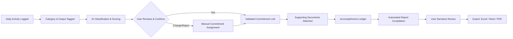

# SYSTEM ARCHITECTURE
## IPCR Accomplishment Tracker & Monitoring System
**National Irrigation Administration (NIA) - Regional Office XI**  
**Planning and Design Section**

---

## 1. High-Level Architecture Overview

The application follows a modern decoupled architecture: a reactive Single-Page Application (SPA) client layer backed by a serverless cloud infrastructure (Google Cloud & Firebase).

```
+-------------------------------------------------------------------------------+
|                             CLIENT APPLICATION LAYER                          |
|                       (React 18 + TypeScript + Vite + Tailwind)               |
|                                                                               |
|  +--------------------+  +--------------------+  +--------------------------+ |
|  |  Presentation      |  |  Application State |  |  Domain Logic            | |
|  |  - Dashboard View  |  |  - Activity Store  |  |  - IPCR Period Matcher   | |
|  |  - Daily Activity  |  |  - Document Store  |  |  - Validation Rules      | |
|  |  - Doc Monitoring  |  |  - Commitment Store|  |  - Export Formatters     | |
|  |  - Report Builder  |  |  - Filter State    |  |  - Deduplication Engine  | |
|  +--------------------+  +--------------------+  +--------------------------+ |
+---------------------------------------+---------------------------------------+
                                        | HTTPS / Secure SDK
                                        v
+-------------------------------------------------------------------------------+
|                            FIREBASE / BACKEND LAYER                           |
|                                                                               |
|  +------------------------+  +---------------------+  +---------------------+ |
|  | Firebase Auth          |  | Cloud Firestore     |  | Firebase Storage    | |
|  | - Email / Password     |  | - Owner-scoped Data |  | - Uploaded Evidence | |
|  | - Single User Boundary |  | - Audit Trails      |  | - Exported Reports  | |
|  | - Session Persistence  |  | - Indexed Queries   |  | - Signed URLs       | |
|  +------------------------+  +---------------------+  +---------------------+ |
|                                                                               |
|  +--------------------------------------------------------------------------+ |
|  | Cloud Functions (v2 Serverless Runtime)                                  | |
|  | - AI Narrative Generation (Gemini 1.5 Pro / Flash via Google AI SDK)     | |
|  | - Activity Classification & Commitment Matcher                           | |
|  | - Report Compilation & Server-side Excel/Word Generation                 | |
|  | - Automated Scheduled Backup Tasks                                       | |
|  +--------------------------------------------------------------------------+ |
+-------------------------------------------------------------------------------+
```

---

## 2. Layer Responsibilities & Directory Structure

```
c:\Users\User-Pc\IPCR\
├── src\
│   ├── assets\                  # Static branding, NIA logos, icons
│   ├── components\
│   │   ├── common\              # UI building blocks (Button, Badge, Modal, Card, Table)
│   │   ├── layout\              # Sidebar, Header, Breadcrumbs, Shell
│   │   ├── dashboard\           # Metrics, Chart widgets, Status breakdown
│   │   ├── activities\          # Activity form, Activity list, Calendar view
│   │   ├── documents\           # Document log sheet, filters, status pills
│   │   ├── commitments\         # IPCR commitment cards, indicators, targets
│   │   ├── reports\             # Report builder, narrative editor, preview
│   │   └── import\              # Historical Excel wizard components
│   ├── contexts\                # Global contexts (Auth, Theme, Notification)
│   ├── hooks\                   # Custom hooks (useActivities, useCommitments, etc.)
│   ├── lib\                     # Utilities, date helpers, cn utility, formatters
│   ├── services\                # Firebase & API clients (Firestore, Functions, Storage)
│   ├── types\                   # TypeScript type definitions and domain interfaces
│   ├── App.tsx                  # Root routing and layout assembly
│   ├── main.tsx                 # App mount and error boundary initialization
│   └── index.css                # Tailwind directives and custom component styles
├── docs\                        # Extended documentation and reference templates
├── public\                      # Public static files
├── index.html                   # HTML template
├── package.json                 # Dependency manifest
├── tsconfig.json                # TypeScript compiler configuration
├── vite.config.ts               # Vite bundler configuration
└── tailwind.config.js           # Tailwind theme configuration
```

---

## 3. End-to-End Operational Workflow

The application operates around a strictly validated pipeline that prevents data inflation and guarantees auditability:



### Detailed Workflow Stages:
1. **Daily Work Capture:**
   The user records work done during the day (e.g., "Detailed engineering review of canal lining for Digos RIS").
2. **AI Classification Support:**
   The backend Cloud Function passes the entry description to the Gemini API alongside active approved IPCR commitments. The model suggests the best-fit commitment code with confidence score and justification.
3. **User Sovereignty:**
   The AI suggestion is strictly advisory. The user can confirm, adjust, or manually link to any approved indicator. Unconfirmed activities are held in an *unclassified* status.
4. **Document Corroboration:**
   Activities are linked with records in the Document Monitoring module (mirroring the official NIA DOC LOG SHEET). One document can support multiple daily activities, but duplicate count claims are blocked.
5. **Report Synthesis:**
   When reporting periods arrive (e.g., 2nd Semester: July - December), the system compiles validated accomplishments, deduplicates deliverables, drafts standard civil engineering accomplishment statements, and populates the official template.

---

## 4. Key Design Principles

1. **Deterministic Financial & Target Integrity:**
   Commitment descriptions, original cell locations (e.g., merged G:H cells in existing IPCR sheets), allotted budgets, and targets are treated as immutable baselines.
2. **Philippine Timezone Enforcement:**
   All timestamp handling and date slicing strictly observe `Asia/Manila` (PHT, UTC+8) to eliminate boundary rollover errors.
3. **No Phantom Accomplishments:**
   Receiving a document or attending a coordination meeting does not equal a completed deliverable. Statuses clearly delineate `In-Progress` from `Completed Output`.
4. **Resilient Offline / Local First:**
   Components provide optimistic UI updates, robust error feedback, and draft auto-saving to prevent loss of long narrative entries.
